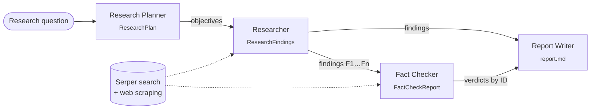

<div align="center">

# Research Agent

**A multi-agent research pipeline that plans, researches, fact-checks and writes cited reports.**

Ask a research question and get back a structured Markdown report. Every claim
in it has been checked against independent sources and traced back to a URL.


[How it works](#how-it-works) · [Design decisions](#design-decisions) · [Quickstart](#quickstart) · [Example output](#example-output) · [Roadmap](#roadmap)

</div>

---

## Highlights

- **Four specialised agents** in a sequential pipeline: planner → researcher → fact checker → writer.
- **Typed handoffs between agents.** Each stage outputs a validated Pydantic model rather than free text, so sources, dates and quotes don't get lost along the way.
- **Claim-level fact-checking.** Every finding gets an ID (`F1`, `F2`, …). The fact checker gives each ID one of five verdicts and cites its own independent sources.
- **Clear rules for using verdicts.** The writer bases the report on supported claims, applies corrections, drops contradicted claims and labels unverifiable ones.
- **Citations throughout.** Every finding keeps its `source_url` from search all the way to the final report.

---

## How it works



| Agent | What it does | Tools | Output |
|---|---|---|---|
| **Research Planner** | Breaks the question into distinct, searchable objectives | — | `ResearchPlan` |
| **Researcher** | Collects evidence for each objective, one fact per finding, with source, quote and date | Serper search, web scraper | `ResearchFindings` |
| **Fact Checker** | Checks every finding against *independent* sources and flags contradictions between findings | Serper search, web scraper | `FactCheckReport` |
| **Report Writer** | Turns the verified findings into a cited Markdown report | — | `report.md` |

### The data contracts

Each finding is recorded as an individual claim with its source:

```python
class Finding(BaseModel):
    id: str                    # "F1", "F2", ...
    claim: str                 # the specific statement
    objective: str             # which research objective it answers
    details: str               # full context, nuance and caveats
    quote: str | None          # verbatim excerpt from the source
    source_url: str
    source_title: str | None
    published_date: str | None
```

The fact checker returns verdicts that **reference findings by ID**:

```python
class Verdict(str, Enum):
    SUPPORTED = "supported"
    PARTIALLY_SUPPORTED = "partially_supported"
    CONTRADICTED = "contradicted"
    OUTDATED = "outdated"
    UNVERIFIABLE = "unverifiable"

class FindingCheck(BaseModel):
    finding_id: str
    verdict: Verdict
    confidence: float          # 0–1
    reasoning: str
    evidence_urls: list[str]   # independent sources consulted
    correction: str | None     # corrected statement where applicable
```

---

## Design decisions

**Structured outputs instead of prose handoffs.**
When agents pass prose to each other, each LLM rewrites and compresses what it receives. Exact figures, dates and URLs tend to disappear first. A schema acts as a contract: `source_url` is required, so it can't be dropped. Free-text fields (`details`, `quote`, `notes`) keep the nuance without making the schema rigid.

**The fact checker references findings instead of repeating them.**
If the fact checker copied each finding into its output, the LLM would rewrite the findings on the way through. Quotes would get paraphrased and URLs mistyped. Outputting only verdicts keyed by `finding_id` leaves the original evidence untouched. The writer matches verdicts to findings by ID.

**Verdicts are an enum, not free text.**
A free-text verdict comes back as "mostly true", "likely accurate" and so on, which code can't filter on. A fixed set of five verdicts lets the writer, and later the evaluation code, branch on them reliably.

**I dropped the planned Analyst agent.**
The original design had a fifth agent that would analyse the findings with Python. In practice, findings from articles are mostly qualitative, so the analyst ended up re-summarising the same text the writer already summarises. Instead of keeping an agent that added cost without adding value, I removed it. Quantitative analysis is still possible later, for topics that produce numeric data.

---

## Quickstart

**Prerequisites:** Python 3.14+, [uv](https://docs.astral.sh/uv/), an [OpenAI API key](https://platform.openai.com/api-keys) and a [Serper API key](https://serper.dev/).

```bash
# 1. Clone and install
git clone https://github.com/doodoobird189/research-agent.git
cd research-agent
uv sync

# 2. Add your API keys
cp .env.example .env
# then edit .env:
#   OPENAI_API_KEY=...
#   SERPER_API_KEY=...
#   OPENAI_MODEL_NAME=gpt-4o-mini

# 3. Run
uv run research-agent "What is Retrieval Augmented Generation and who are the main vendors?"
# you'll be asked for a report name, e.g. "rag"
```

### Usage

```bash
uv run research-agent "What is RAG?"                       # asks for a report name
uv run research-agent "What is RAG?" --name rag            # name given up front
uv run research-agent "What is RAG?" --name rag --output-dir my_reports
uv run research-agent --help
```

Each run is saved to its own folder, named after the report:

```
reports/rag/
├── report.md         # the final cited report
├── findings.json     # every finding from the researcher (ResearchFindings)
└── fact_check.json   # every verdict from the fact checker (FactCheckReport)
```

Report names must be unique. If the name is already taken, the run stops before any research starts, so no API calls are wasted. Keeping the structured findings and verdicts next to the report lets you trace any statement back to its evidence, and gives future evaluations data to work with.

> **Note:** each run makes many LLM calls and web searches. Start with a narrow question to keep cost and runtime down.

---

## Example output

> **Question:** *"What is Retrieval Augmented Generation and who are the main vendors?"*

Excerpt from the generated report ([full report](examples/rag_report.md)):

> **Key Vendors in RAG Technologies**
>
> 1. **Primary Vendors**: Key vendors in the RAG market include OpenAI, Microsoft, Google, and Amazon Web Services (AWS). Additional players identified are NVIDIA and emerging companies in the AI landscape (F7, [Mordor Intelligence](https://www.mordorintelligence.com/industry-reports/retrieval-augmented-generation-market)).
>
> **Market Trends and Future Directions**
>
> 1. **Market Growth**: The RAG market is anticipated to experience significant growth, projected to reach USD 10.2 billion by 2030 […] (F9, [Mordor Intelligence](https://www.mordorintelligence.com/industry-reports/retrieval-augmented-generation-market)).

Each statement carries its finding ID and source link, so you can trace it back through the fact-check report to the original evidence.

---

## Project structure

```
research-agent/
├── src/research_agent/
│   ├── main.py                     # Typer CLI (`uv run research-agent "question"`)
│   ├── config/
│   │   ├── agents.yaml             # roles, goals, backstories
│   │   └── tasks.yaml              # task instructions and expected outputs
│   ├── crews/
│   │   └── research_crew.py        # wires agents, tasks and output models
│   ├── models/
│   │   ├── research_models.py      # ResearchPlan, Finding, ResearchFindings
│   │   └── fact_checker_models.py  # Verdict, FindingCheck, FactCheckReport
│   └── tools/
│       ├── search_tool.py          # Serper (Google search)
│       └── scraping_tool.py        # website scraping
├── examples/
│   └── rag_report.md               # sample output
├── .env.example
├── pyproject.toml
└── uv.lock
```

---

## Roadmap

- [ ] **Evaluation suite:** plant false claims and measure how many the fact checker catches; automatically check that cited quotes really appear at their URLs.
- [ ] **Parallel research per objective:** use a CrewAI Flow to start one research task per planned objective, rather than one task covering all of them.
- [x] **Command-line interface** with one output folder per run.
- [ ] **Validation in code:** confirm that every `finding_id` in the fact-check report exists, and treat any unchecked finding as unverified.
- [ ] **Cost and latency tracking:** report tokens, dollars and duration per run.
- [ ] **Tests** for the models and pipeline wiring.

---

## Tech stack

[CrewAI](https://github.com/crewAIInc/crewAI) · [Pydantic](https://docs.pydantic.dev/) · [Serper](https://serper.dev/) · OpenAI · [Typer](https://typer.tiangolo.com/) · [uv](https://docs.astral.sh/uv/) · [Ruff](https://docs.astral.sh/ruff/)
