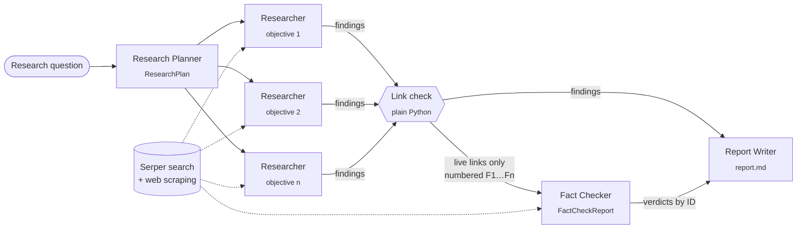

<div align="center">

# Research Agent

**A multi-agent research pipeline that plans, researches, fact-checks and writes cited reports.**

Ask a research question and get back a structured Markdown report. Every claim
in it has been checked against independent sources and traced back to a URL.


[How it works](#how-it-works) · [Design decisions](#design-decisions) · [Quickstart](#quickstart) · [Example output](#example-output)

</div>

---

## Highlights

- **A CrewAI Flow with four specialised agents:** a planner splits the question into objectives, one researcher per objective works in parallel, then a fact checker and a writer finish the job.
- **Fabricated sources are caught in code.** Every source URL is checked before fact-checking, and findings with dead or invented links are dropped.
- **Typed handoffs between agents.** Each stage outputs a validated Pydantic model rather than free text, so sources, dates and quotes don't get lost along the way.
- **Claim-level fact-checking.** Every finding gets an ID (`F1`, `F2`, …). The fact checker gives each ID one of five verdicts and cites its own independent sources.
- **Clear rules for using verdicts.** The writer bases the report on supported claims, applies corrections, drops contradicted claims and labels unverifiable ones.
- **Citations throughout.** Every finding keeps its `source_url` from search all the way to the final report.

---

## How it works



The pipeline is a [CrewAI Flow](https://docs.crewai.com/concepts/flows) ([`flow.py`](src/research_agent/flow.py)). Each stage is a small single-agent crew, and the Flow passes typed state between them.

| Agent                | What it does                                                                                 | Tools                      | Output             |
| -------------------- | -------------------------------------------------------------------------------------------- | -------------------------- | ------------------ |
| **Research Planner** | Breaks the question into distinct, searchable objectives                                     | —                          | `ResearchPlan`     |
| **Researcher**       | One per objective, run in parallel. Collects evidence, one fact per finding, with source, quote and date | Serper search, web scraper | `ResearchFindings` |
| _Link check (code)_  | Requests every source URL and drops findings whose page doesn't exist                         | `httpx`                    | live findings      |
| **Fact Checker**     | Checks every finding against _independent_ sources and flags contradictions between findings | Serper search, web scraper | `FactCheckReport`  |
| **Report Writer**    | Turns the verified findings into a cited Markdown report                                     | —                          | `report.md`        |

### The data contracts

Each finding is recorded as an individual claim with its source:

```python
class Finding(BaseModel):
    id: str = ""               # "F1", "F2", ... assigned in code
    claim: str                 # the specific statement
    objective: str = ""        # set in code to the objective researched
    details: str               # full context, nuance and caveats
    quote: str | None          # verbatim excerpt from the source
    source_url: str
    source_title: str | None
    published_date: str | None
```

The fact checker returns verdicts that **reference findings by ID**:

```python
class Verdict(str, Enum):
    SUPPORTED = "supported"
    PARTIALLY_SUPPORTED = "partially_supported"
    CONTRADICTED = "contradicted"
    OUTDATED = "outdated"
    UNVERIFIABLE = "unverifiable"

class FindingCheck(BaseModel):
    finding_id: str
    verdict: Verdict
    confidence: float          # 0–1
    reasoning: str
    evidence_urls: list[str]   # independent sources consulted
    correction: str | None     # corrected statement where applicable
```

---

## Design decisions

**Structured outputs instead of prose handoffs.**
When agents pass prose to each other, each LLM rewrites and compresses what it receives. Exact figures, dates and URLs tend to disappear first. A schema acts as a contract: `source_url` is required, so it can't be dropped. Free-text fields (`details`, `quote`, `notes`) keep the nuance without making the schema rigid.

**The fact checker references findings instead of repeating them.**
If the fact checker copied each finding into its output, the LLM would rewrite the findings on the way through. Quotes would get paraphrased and URLs mistyped. Outputting only verdicts keyed by `finding_id` leaves the original evidence untouched. The writer matches verdicts to findings by ID.

**Verdicts are an enum, not free text.**
A free-text verdict comes back as "mostly true", "likely accurate" and so on, which code can't filter on. A fixed set of five verdicts lets the writer branch on them reliably.

**One researcher per objective, using a Flow.**
The first version was a single sequential crew in which one researcher covered every objective. Its research was thin: 4–5 findings per question, often from a single website, and whole parts of the question went unanswered. The Flow gives each objective its own researcher, with its own focus and search budget, and runs them in parallel. Finding IDs are assigned in code after the results are merged, so they stay unique across researchers.

**Fabricated URLs are caught in code, not by another LLM.**
In testing, a researcher invented a source URL on a domain that doesn't exist, and the fact checker, being another LLM, marked it "supported". So between research and fact-checking, a plain Python step requests every source URL. Findings whose site doesn't respond or whose page returns 404/410 are dropped and saved to `dead_links.json`. Responses like 403 count as live, because many real sites block automated requests.

**I dropped the planned Analyst agent.**
The original design had a fifth agent that would analyse the findings with Python. In practice, findings from articles are mostly qualitative, so the analyst ended up re-summarising the same text the writer already summarises. Instead of keeping an agent that added cost without adding value, I removed it.

---

## Quickstart

**Prerequisites:** Python 3.14+, [uv](https://docs.astral.sh/uv/), an [OpenAI API key](https://platform.openai.com/api-keys) and a [Serper API key](https://serper.dev/).

```bash
# 1. Clone and install
git clone https://github.com/doodoobird189/research-agent.git
cd research-agent
uv sync

# 2. Add your API keys
cp .env.example .env
# then edit .env:
#   OPENAI_API_KEY=...
#   SERPER_API_KEY=...
#   OPENAI_MODEL_NAME=gpt-4o

# 3. Run
uv run research-agent "What is Retrieval Augmented Generation and who are the main vendors?"
# you'll be asked for a report name, e.g. "rag"
```

### Usage

```bash
uv run research-agent "What is RAG?"                       # asks for a report name
uv run research-agent "What is RAG?" --name rag            # name given up front
uv run research-agent "What is RAG?" --name rag --output-dir my_reports
uv run research-agent --help
```

Each run is saved to its own folder, named after the report:

```
reports/rag/
├── report.md         # the final cited report
├── findings.json     # every finding from the researcher (ResearchFindings)
├── fact_check.json   # every verdict from the fact checker (FactCheckReport)
└── dead_links.json   # findings dropped because their source URL doesn't exist
```

Report names must be unique. If the name is already taken, the run stops before any research starts, so no API calls are wasted. Keeping the structured findings and verdicts next to the report lets you trace any statement back to its evidence.

> **Note:** each run makes many LLM calls and web searches. Start with a narrow question to keep cost and runtime down.

---

## Example output

Three complete runs, generated with `gpt-4o`. Each folder contains the final report plus the structured findings and fact-check verdicts behind it.

| Question | Findings | Objectives | Distinct sources | Run |
|---|---|---|---|---|
| What are the main approaches to commercial fusion power, who leads each, and how realistic are their timelines? | 19 | 5 | 9 | [`fusion-energy/`](examples/fusion-energy/) |
| What is the state of humanoid robotics: leading companies, technologies, opportunities and challenges? | 17 | 5 | 12 | [`humanoid-robotics/`](examples/humanoid-robotics/) |
| How do solid-state batteries compare with lithium-ion for EVs, and who is closest to commercialising them? | 14 | 5 | 10 | [`solid-state-batteries/`](examples/solid-state-batteries/) |

Excerpt from the [fusion report](examples/fusion-energy/report.md):

> - **Helion Energy** anticipates reactor startup in 2028 and full power by 2029 or 2030, a timeline viewed with optimism due to technological advancements but also skepticism given historical challenges in the sector (F9, [World Nuclear Association](https://world-nuclear.org/information-library/current-and-future-generation/nuclear-fusion-power)).
> - **ITER**'s first plasma operation has been delayed, revising earlier projections of 2025, indicating the substantial technical challenges inherent in achieving dependable fusion reactions (F10, [World Nuclear News](https://www.world-nuclear-news.org/Articles/ITER-delays-revision-of-project-s-timeline)).

Each statement carries its finding ID and source link. You can look up the ID in `findings.json` to see the original evidence, and in `fact_check.json` to see its verdict.

---

## Project structure

```
research-agent/
├── src/research_agent/
│   ├── main.py                     # Typer CLI (`uv run research-agent "question"`)
│   ├── config/
│   │   ├── agents.yaml             # roles, goals, backstories
│   │   └── tasks.yaml              # task instructions and expected outputs
│   ├── flow.py                     # the pipeline: plan → research → link check → fact-check → write
│   ├── crews.py                    # one small crew per stage, built from the YAML
│   ├── models/
│   │   ├── research_models.py      # ResearchPlan, Finding, ResearchFindings
│   │   └── fact_checker_models.py  # Verdict, FindingCheck, FactCheckReport
│   └── tools/
│       ├── search_tool.py          # Serper (Google search)
│       └── scraping_tool.py        # website scraping
├── examples/                       # three complete example runs
├── .env.example
├── LICENSE
├── pyproject.toml
└── uv.lock
```

---

## Tech stack

[CrewAI](https://github.com/crewAIInc/crewAI) · [Pydantic](https://docs.pydantic.dev/) · [Serper](https://serper.dev/) · [OpenAI](https://openai.com/) · [Typer](https://typer.tiangolo.com/) · [uv](https://docs.astral.sh/uv/) · [Ruff](https://docs.astral.sh/ruff/)

---

## License

Released under the [MIT License](LICENSE).
